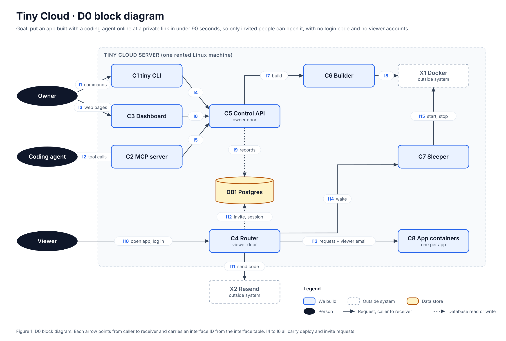
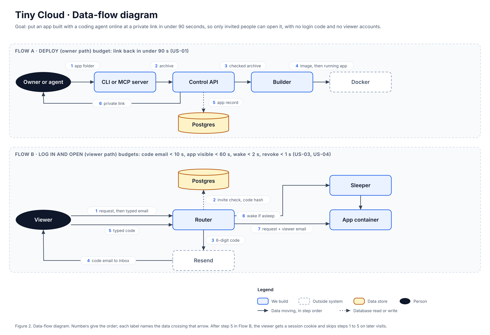

# D0 High-Level Design

CS 5001 Senior Design I, Assignment 5

**Project:** Tiny Cloud

**Team members:** Pratham Prabhu, Phani Bharadwaj Jarugumilli

**Advisor:** Pratyush Srivastava

## 1. Title, goal statement, and conventions

**Goal statement:** Tiny Cloud lets a person who built an app with a coding agent put it online at a private link in under 90 seconds, so that only the people they invite can open it, without anyone writing login code or making an account.

**Basic input:** an app folder from the owner (or the owner's coding agent), plus a list of email addresses to invite.

**Basic output:** a private HTTPS link to the running app, which opens only for invited people after they enter a 6-digit code sent to their email.

**Conventions (also shown as a legend on both diagrams):**

- Solid blue box: a component we build.
- Dashed grey box: an outside system we use but do not build (Docker, Resend).
- Yellow cylinder: a data store.
- Dark oval: a person (owner, coding agent, viewer).
- Solid arrow: a request or call, pointing from the caller to the receiver. Each arrow carries an interface ID (I1, I2, ...) that matches the table in part 4.
- Dotted arrow: a database read or write.

## 2. Block diagram (D0)



## 3. Component responsibility table

| ID | Component | Responsibility (one sentence) | Interfaces in | Interfaces out | Owner |
| --- | --- | --- | --- | --- | --- |
| C1 | tiny CLI | Turns the owner's typed commands into Control API requests. | I1 | I4 | Pratham |
| C2 | MCP server | Turns a coding agent's tool calls into Control API requests. | I2 | I5 | Pratham |
| C3 | Dashboard | Shows the owner their apps and invites in a browser. | I3 | I6 | Pratham |
| C4 | Router | Decides whether each viewer request may reach an app. | I10 | I11, I12, I13, I14 | Pratham |
| C5 | Control API | Checks owner requests and records apps and invites. | I4, I5, I6 | I7, I9 | Phani |
| C6 | Builder | Turns an uploaded app folder into a runnable container image. | I7 | I8 | Phani |
| C7 | Sleeper | Starts and stops app containers based on use. | I14 | I15 | Phani |
| C8 | App containers | Run one owner app each, walled off from the others. | I13 | none | Phani |
| DB1 | Postgres | Stores owners, apps, invites, sessions, and login codes. | I9, I12 | none | Phani |
| X1 | Docker (outside) | Builds and runs containers on the server. | I8, I15 | none | not ours |
| X2 | Resend (outside) | Delivers the login-code email. | I11 | none | not ours |

## 4. Interface specification table

| ID | From -> To | Inputs | Outputs | Format | Protocol | On error, and who handles it |
| --- | --- | --- | --- | --- | --- | --- |
| I1 | Owner -> CLI | command (string), app folder path (string), emails (list of strings) | printed link and status | command-line text | local terminal | CLI prints a plain error and exits with a non-zero code |
| I2 | Agent -> MCP server | tool name (string), arguments (JSON object) | tool result (JSON object) | JSON | MCP over stdio | MCP server returns an error result with a message the agent can act on |
| I3 | Owner -> Dashboard | clicks and form fields | web pages | HTML | HTTPS | Dashboard shows an error message on the page |
| I4 | CLI -> Control API | deploy token (string), app name (string), app archive (file) or invite (email string) | app name, link (string), status (string) | JSON, or multipart for the upload | HTTPS | API returns 400/401/409 with an error code; CLI shows it |
| I5 | MCP server -> Control API | same as I4 | same as I4 | same as I4 | HTTPS | same as I4; MCP server passes the error to the agent |
| I6 | Dashboard -> Control API | session cookie, invite or revoke action | updated list (JSON) | JSON | HTTPS | API returns 401/404; Dashboard shows it |
| I7 | Control API -> Builder | app name (string), archive path (string) | image ID (string) or build error (string) | JSON | local HTTP call | Builder returns the failure reason; Control API marks the deploy failed and returns it to the owner |
| I8 | Builder -> Docker | build context (folder) | image ID (string), build log (text) | Docker API calls | Unix socket (Docker Engine API) | Builder stops after 120 s and reports "build failed" |
| I9 | Control API -> Postgres | rows: owners, apps, invites | rows, success or failure | SQL | Postgres wire protocol | Control API returns 500 and logs it; no partial invite is saved (transaction) |
| I10 | Viewer -> Router | browser request, session cookie (optional), email or code from login form | app page, login page, or "access denied" | HTML | HTTPS | Router shows the login page, a "code expired" message, or "access denied" |
| I11 | Router -> Resend | to (email), code (6 digits), app name | message ID (string) | JSON | HTTPS (Resend API) | Router retries once; if it still fails, it shows "could not send code, try again" |
| I12 | Router -> Postgres | email, code hash, session hash | invite yes or no, session valid yes or no | SQL | Postgres wire protocol | Router refuses the request (fails closed) and shows "try again later" |
| I13 | Router -> App container | original request plus `X-Tiny-Email` header set by the Router | app response | HTTP | HTTP on a private Docker network | Router shows "app is starting" for up to 2 s, then "app unavailable" |
| I14 | Router -> Sleeper | app name (string) | ready yes or no, container address (string) | JSON | local HTTP call | Sleeper answers "not ready" after 2 s; Router shows "app unavailable" |
| I15 | Sleeper -> Docker | start or stop, container ID | container state | Docker API calls | Unix socket (Docker Engine API) | Sleeper logs the failure and leaves the app marked stopped |

**Example payload (I4, deploy response from the Control API):**

```json
{
  "app": "poll",
  "owner": "pratham",
  "url": "https://poll-pratham.tinycloud.dev",
  "status": "running",
  "deployed_at": "2026-11-24T19:45:00Z"
}
```

**Example error (I4, missing start script):**

```json
{
  "error": "missing_start_script",
  "message": "package.json has no start script. Add one and deploy again."
}
```

## 5. Data-flow diagram



**Flow A, deploy (owner path). Timing budget: link back in under 90 seconds (US-01).**

1. App folder (files on the owner's laptop) -> CLI or MCP server
2. Archive (compressed file) -> Control API
3. Checked archive (start script present, app rules met) -> Builder
4. Container image -> Docker
5. Running container -> Control API
6. App record (stored row) -> Postgres
7. Private link (URL text) -> owner

**Flow B, viewer login and visit (viewer path). Timing budget: code email within 10 seconds; app visible within 60 seconds of opening the link; a sleeping app wakes in under 2 seconds; a removed person is cut off within 1 second (US-03, US-04).**

1. Browser request (no session) -> Router
2. Typed email (form field) -> Router -> invite check (stored row in Postgres)
3. 6-digit code (email message) -> Resend -> viewer's inbox
4. Typed code (form field) -> Router -> code check (hash in Postgres)
5. Session cookie (random token, hash stored) -> viewer's browser
6. Request plus viewer email header -> app container (woken by the Sleeper if asleep)
7. App page (HTML) -> viewer

## 6. Architecture pattern and justification

**Patterns used:**

- **Client-server** governs the whole system. Owners and viewers are clients; the Tiny Cloud server is the single server.
- **Layered** governs the server. The front layer is the Router (every viewer request) and the Control API (every owner request). The middle layer is the Builder and Sleeper. The bottom layer is Docker and Postgres. A layer only calls the layer below it.
- **Pipeline** governs deploy: upload, check, build, run, record. Each stage passes its output to the next and can stop the deploy with a clear error.

**Justification against the five criteria:**

- **Fit to the problem:** the core job is a gate in front of many small apps. One Router that every request must pass through fits that directly, and it is the only place access is decided.
- **Team skills:** both of us have built Node.js web servers and used Docker. A single server with a few services is within what two people can build in one semester.
- **Performance and timing:** keeping everything on one machine means the Router, Sleeper and apps talk over local connections, which helps the 2-second wake and 1-second revoke targets.
- **Scalability:** the target is about 20 small apps with a handful of viewers each. One server is enough; we do not need to spread across machines.
- **Hardware constraints:** our budget is one $20 to $30 per month server (Week 3 constraints). Sleeping idle apps keeps memory use inside that one machine.

**Rejected pattern: microservices.** Splitting each component into its own separately deployed service would add networking, service discovery and more failure points. For two people and one server, that cost buys nothing. We keep clear component boundaries inside one deployment instead.

**Also rejected: serverless functions.** Owner apps keep saved data on disk and hold open connections, which does not fit short-lived functions, and it would move us off a self-hosted server.

## 7. Decision log

| # | Decision | Alternatives considered | Why the chosen option won |
| --- | --- | --- | --- |
| D1 | Viewers log in with a 6-digit code sent to their email | Passwords; Google or GitHub sign-in; a shared password per app | No account and no password for viewers, and we store no passwords. Sign-in providers would force viewers to have those accounts. A shared password cannot remove one person. |
| D2 | Each app runs in its own Docker container | Plain processes on the server; full virtual machines | Containers give each app its own files and limits at low cost. Plain processes share too much. Virtual machines are too heavy for 20 apps on one small server. |
| D3 | One Router decides every viewer request and passes the viewer's email to the app in a header | Each app does its own login | Apps need no login code, access is decided in one place, and revoke works the same for every app. The Router removes any copy of the header a client sends, so it cannot be faked. |
| D4 | Postgres for platform data; one SQLite file per app for app data | One shared database for everything | Platform data (invites, sessions) needs reliable transactions. Separate per-app files keep one app's data out of reach of the others and are deleted with the app. |
| D5 | Apps sleep after 10 minutes idle and wake on the next request | Keep every app running all the time | Only active apps use memory, which is how 20 apps fit on one budget server. The cost is a short wake delay, capped at 2 seconds. |
| D6 | Owners can deploy from both a CLI and an MCP server, over the same Control API | CLI only; dashboard only | Owners who type commands and owners who ask their coding agent both get a one-step deploy, and both share one set of rules and checks. |
